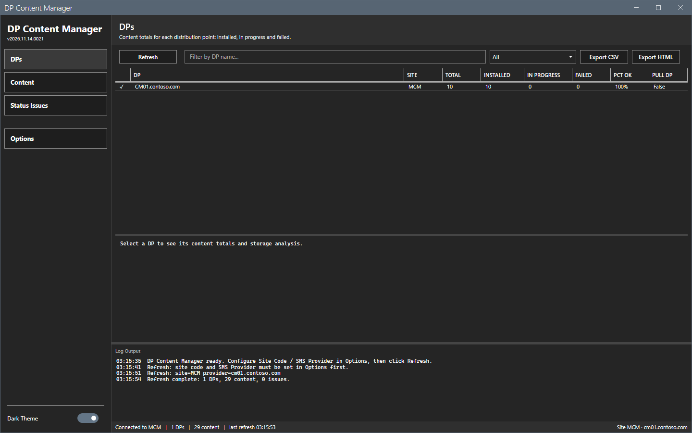

# DP Content Manager

[](https://github.com/jasonulbright/dp-content-manager/releases/latest)
[](https://github.com/jasonulbright/dp-content-manager/releases)
[](#requirements)
[](LICENSE)

Manage Configuration Manager distribution point content: rollups for each distribution point and each content object, a triage view for non-OK rows, bulk redistribute / remove / validate with mandatory preview-before-commit, and CSV / HTML export.



## User guide

The [user guide](docs/index.md) walks every view, dialog and setting with images of the running window. [Capture the images again](docs/reference/capture-images.md) shows the one command that regenerates them.

## Requirements

- Windows 10 / 11 or Server 2016+
- PowerShell 5.1
- .NET Framework 4.7.2+
- Configuration Manager console installed (provides the `ConfigurationManager` PowerShell module)
- Configuration Manager RBAC rights to read distribution point content + redistribute / remove content

## Quick Start

1. Download the release zip and extract it to a working folder.
2. Right-click `start-dpcontentmgr.ps1` -> **Run with PowerShell**, or from a PowerShell prompt:

   ```powershell
   powershell -ExecutionPolicy Bypass -File start-dpcontentmgr.ps1
   ```
3. Select **Options** on the sidebar and set Site Code and SMS Provider. The footer then shows the site at the right end, for example `Site MCM`, a middle dot, and `cm01.contoso.com`. The footer is read-only. Select the site text to open Options.
4. Select **Refresh** to load distribution points, content, and bulk distribution status.

## Layout

The shell uses a sidebar layout with three views and an Options modal:

- **DPs** -- rollup grid for each distribution point: glyph status, distribution point, site, total content, installed, in progress, failed, % OK, Pull DP. Detail panel shows storage analysis (TotalSizeGB) for the selected distribution point.
- **Content** -- per-content-object rollup: glyph, name, type, PackageID, size, distribution points targeted, installed, failed, % OK. Selecting a row populates a status grid for each distribution point below. Action buttons: Redistribute Failed, Remove From DP, Validate.
- **Status Issues** -- the triage view: every (DP, Content) row currently in a non-OK state. Multi-select + Redistribute Selected or Remove Failures for bulk remediation.

## Content Types

- Applications
- Packages (legacy)
- Software Update Deployment Packages (SUDPs)
- Boot Images
- OS Images
- Driver Packages
- Task Sequence referenced content

## Bulk Operation Safety

Every destructive bulk action (Redistribute, Remove From DP, Validate) opens a preview dialog showing the **full (DP, Content) impact list** before running. Select the run button (**<action> <n>**, for example **Remove 12**) to run each row with live OK / FAIL status and a short failure note for each row. The dialog's "Close" only enables AFTER the run completes. So an accidental "remove all failed across 200 distribution points" without seeing the list first is impossible.

## Scale-Optimized Status Queries

Bulk status uses a single CIM query against `SMS_PackageStatusDistPointsSummarizer` instead of iterating per-content cmdlets, with O(n) hashtable aggregation in the module. Designed for environments with 300 or more distribution points where per-object iteration would take 40+ minutes.

> **Why CIM here:** No ConfigurationManager PowerShell cmdlet exposes the bulk content state of each distribution point across all content objects. The summarizer class is the only way to get this data in a single query. All other operations (content retrieval, validation, removal) use ConfigMgr cmdlets.

## Filtering

- **DPs view** -- text filter on distribution point name + status filter (All / Healthy only / Has failures / Has in-progress)
- **Content view** -- text filter on content name or PackageID + content-type filter (All / Application / Package / SUDP / BootImage / OSImage / DriverPackage / TaskSequence)
- **Status Issues view** -- text filter on distribution point or content name + state filter (All / Failed only / In progress only)

## Export

CSV and HTML export of the active view. Files land under `Reports/` by default.

## Project Structure

```
dp-content-manager/
+- start-dpcontentmgr.ps1                    # WPF shell
+- MainWindow.xaml                           # Main window layout
+- Lib/                                      # Vendored MahApps.Metro 2.4.10
|  \- SuiteCommon/                           # Vendored shared core: logging + ConfigMgr connection
+- Module/
|  +- DPContentMgrCommon.psd1                # Module manifest
|  \- DPContentMgrCommon.psm1                # Business logic (21 functions)
+- Logs/                                     # Session logs (per-run)
+- Reports/                                  # CSV / HTML exports
+- CHANGELOG.md
+- LICENSE
\- README.md
```

## Safety

- All bulk destructive operations are gated by the preview-before-commit dialog.
- WMI bulk-status query is read-only.
- Refresh uses a background runspace so the UI stays responsive during 30s+ enumerations on large sites.
- Removal and validation use ConfigMgr cmdlets (`Remove-CMContentDistribution`, `Invoke-CMContentValidation`) from the ConfigurationManager PowerShell module. Redistribution sets `RefreshNow` on the `SMS_DistributionPoint` class by using CIM.

## License

This project is licensed under the [MIT License](LICENSE).

## Author

Jason Ulbright
