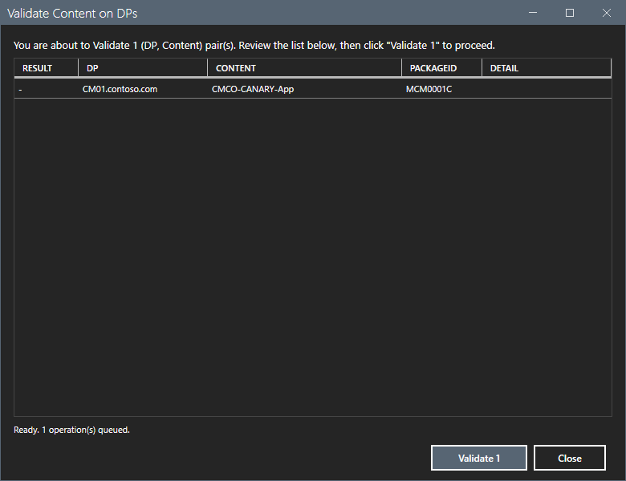

# Bulk action dialog

Every bulk action opens this dialog before it changes anything.

## What it does

The dialog shows the full list of (DP, content) pairs that the action touches. You review the list. The run button, for example **Validate 1**, runs the operations one by one. Each row shows OK or FAIL and the error. The **Close** button stays disabled while the run is in progress. This prevents a run of a large list that you did not read.

## When to use it

It opens when you select **Redistribute Failed...**, **Remove from DP...**, **Validate...**, **Redistribute Selected...** or **Remove Failures...**.

## Requirements

- A connection and a refresh.
- Configuration Manager rights for the action.

## Steps

1. Read the text at the top: `You are about to <action> <n> (DP, Content) pair(s). Review the list below, then click "<action> <n>" to proceed.`
2. Read the list. The columns are **Result**, **DP**, **Content**, **PackageID** and **Detail**.

3. Select the run button to run the list, or select **Close** to leave without a change.
4. After a run, read the **Result** and **Detail** columns. The log shows `<action>: <n> succeeded, <n> failed across <n> operations.` The tool then refreshes the data.

This guide selected **Close** in the previews. It did not run an action. The run and the result were read from the code and the README only.

## Options and settings of this page

| Control | Effect |
|---|---|
| Run button (`<action> <n>`) | Runs the listed operations. |
| **Close** | Closes the dialog. It is disabled during a run. |

## Limits

- The list cannot be edited in the dialog. Select other rows and open the dialog again.
- A failed operation does not stop the run. The result shows each failure.
- When the list is empty, no dialog opens. The log shows `<action>: no matching operations to perform.`

## Troubleshooting

| Message or symptom | Cause | Fix |
|---|---|---|
| No dialog opens. | The selection has no matching operations. | Select other rows. Read the log. |
| A row shows FAIL. | The site refused the operation. | Read the **Detail** column. |

## Links

- [Content](content.md)
- [Status Issues](status-issues.md)
