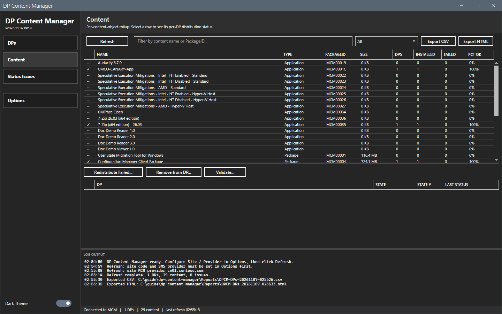
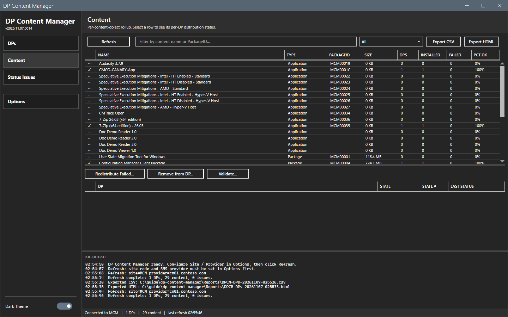
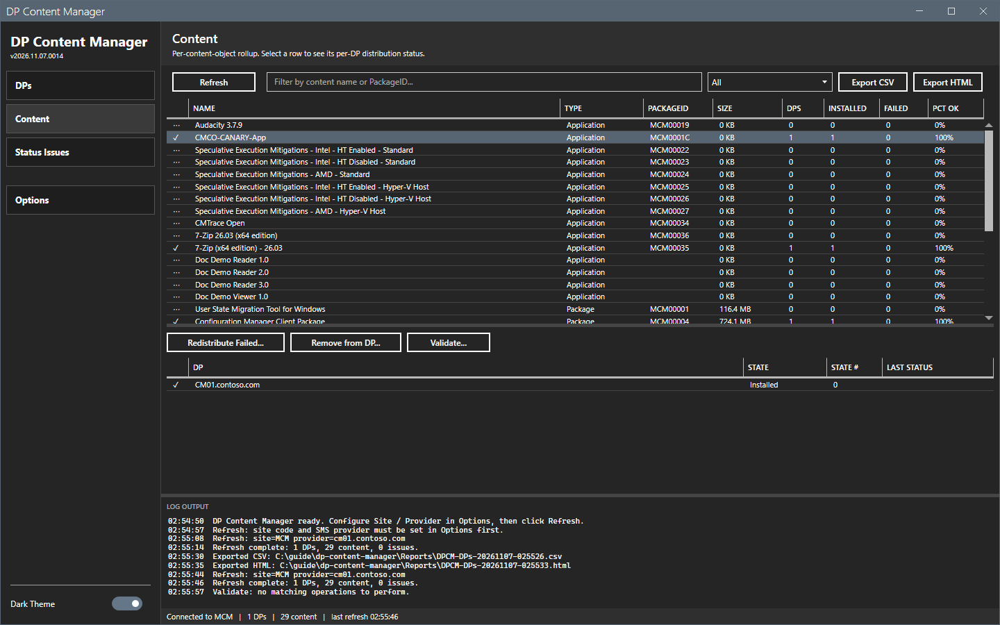
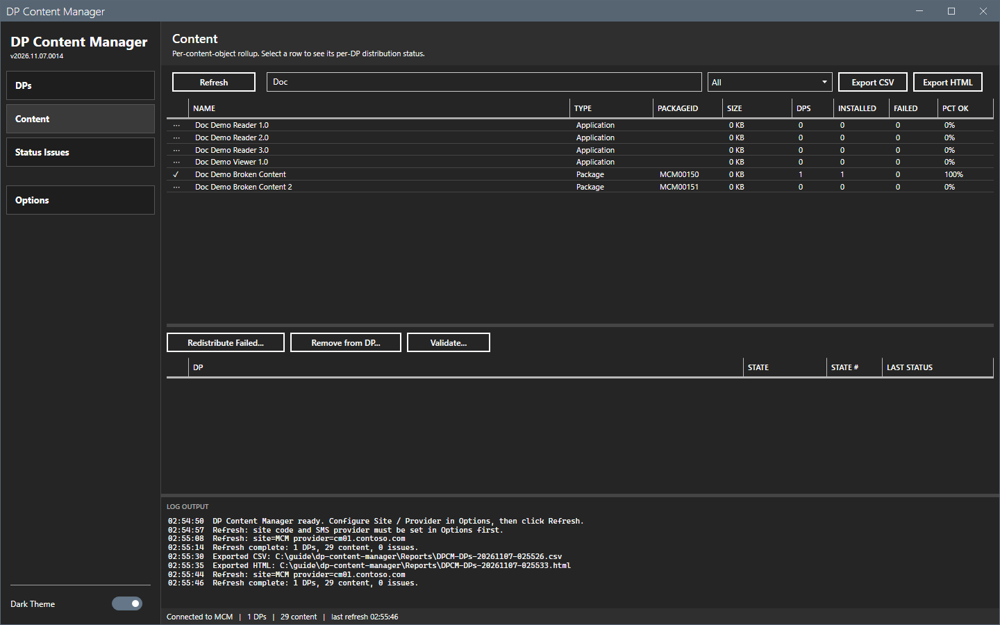
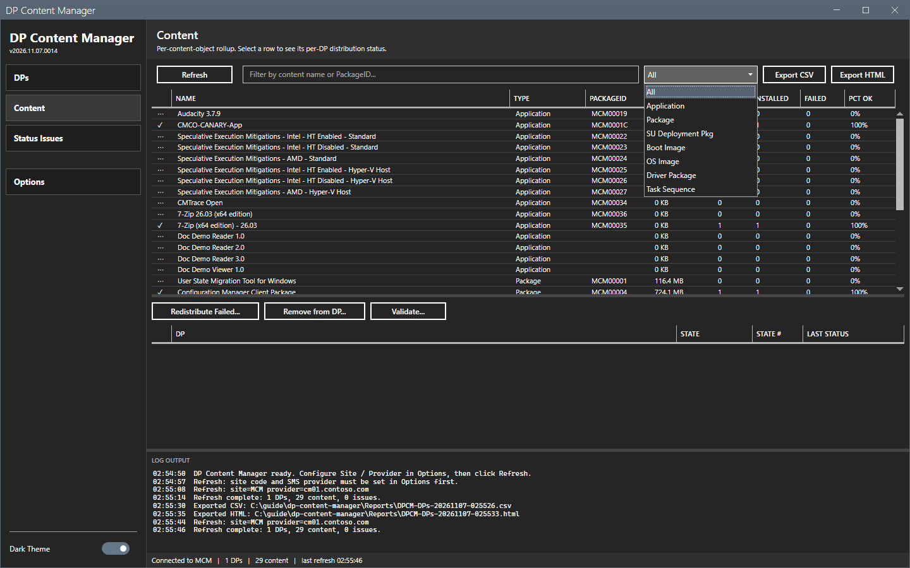
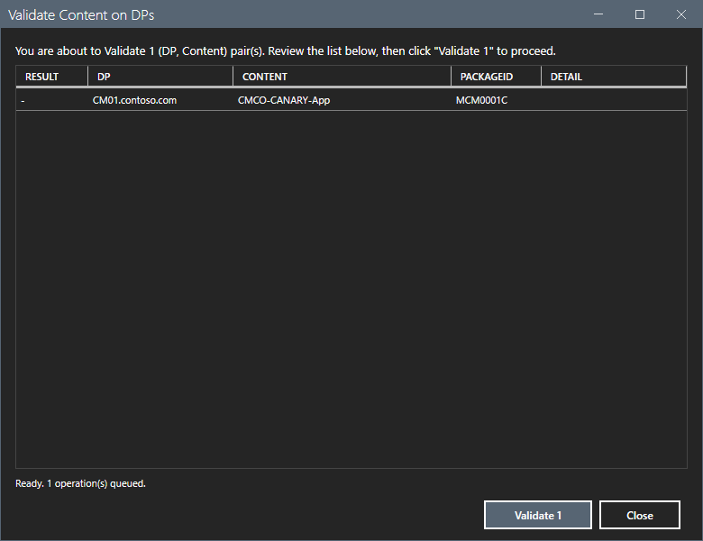
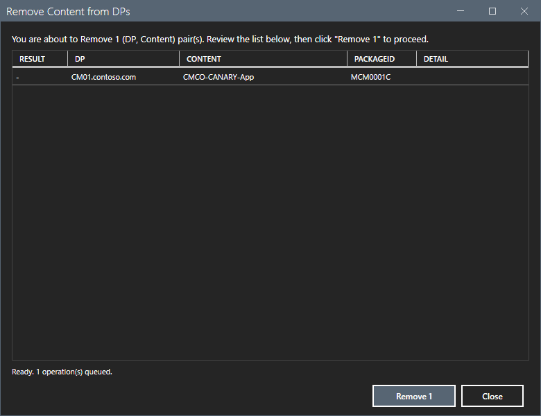
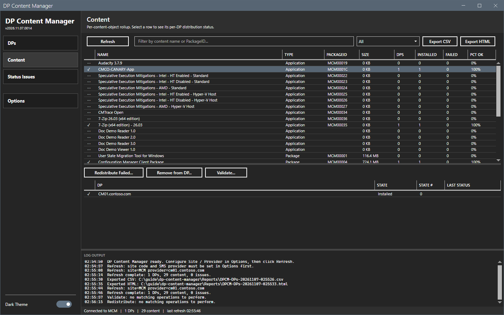

# Content

The Content view shows one row for each content object and its status on each distribution point.

## What it does

Each row shows a status glyph, the name, the type, the package ID, the size, the number of DPs that the content targets, the number installed and failed, and the percent OK. Select a row to see the status on each DP below the grid. Three buttons act on the selected content: **Redistribute Failed...**, **Remove from DP...** and **Validate...**. Each opens a preview first. See [Bulk action dialog](bulk-actions.md).

## When to use it

Use it to find out where a content object is, and to fix or remove it on its DPs.

## Requirements

- A connection and a refresh. See [Getting started](../getting-started.md).
- For the three buttons: Configuration Manager rights to redistribute, remove and validate content.

## Steps

### Read the roll-up

1. Select **Content** in the sidebar. The view is empty before the first refresh.

2. Select **Refresh**. The grid lists the applications, packages, software update deployment packages, boot images, OS images, driver packages and task sequence content.

3. Select a row. The grid below shows each DP with the state, the state number and the last status.

### Filter the view

1. Type text in the filter box. The grid matches the content name and the package ID.
2. Select a type in the list: **All**, **Application**, **Package**, **SU Deployment Pkg**, **Boot Image**, **OS Image**, **Driver Package** or **Task Sequence**. The list holds exactly the types that the **Type** column shows.

### Validate, redistribute or remove

1. Select one or more rows.
2. Select **Validate...**, **Redistribute Failed...** or **Remove from DP...**. A preview dialog lists every (DP, content) pair that the action touches.

3. Select the run button to run the list, or **Close** to leave without a change. See [Bulk action dialog](bulk-actions.md).

This guide opened the previews and selected **Close**. It did not run an action. **Redistribute Failed...** opens a preview only when the selected content has a failed DP. Otherwise the log shows `Redistribute: no matching operations to perform.` The results of the actions were not checked.

## Options and settings of this page

| Control | Effect |
|---|---|
| **Refresh** | Reads all data from the site. |
| Filter box and type list | Filter the grid. |
| **Export CSV**, **Export HTML** | Write the shown rows. |
| **Redistribute Failed...** | Previews a redistribution of the failed DPs of the selected content. |
| **Remove from DP...** | Previews the removal of the selected content from all its DPs. |
| **Validate...** | Previews a validation of the selected content on all its DPs. |

## Limits

- **Remove from DP...** and **Validate...** use every DP that has a status row for the content. Content with no status row has no operation, and the log shows `no matching operations to perform`.
- The three buttons need a selected row and a refresh. Without one, the log says to select rows first, or to refresh first.

## Troubleshooting

| Message or symptom | Cause | Fix |
|---|---|---|
| `Validate: select one or more content rows first.` | No row is selected. | Select a row. |
| `Validate: refresh first to establish a CM connection.` | No refresh has run. | Select **Refresh**. |
| `Validate: no matching operations to perform.` | The content has no DP status row. | Select content that is on a DP. |

## Links

- [Bulk action dialog](bulk-actions.md)
- [Status Issues](status-issues.md)
