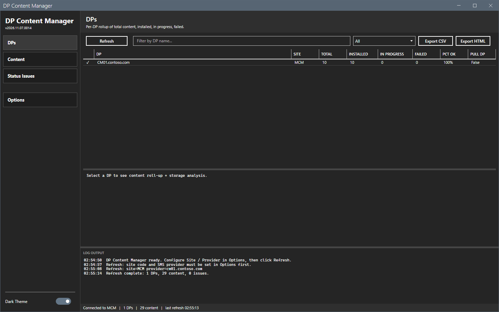
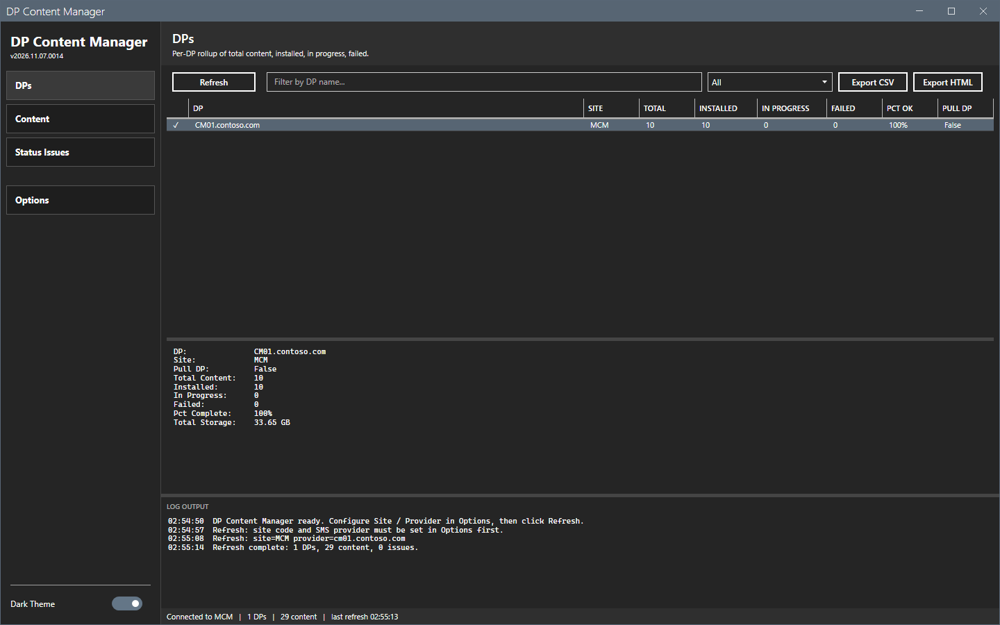
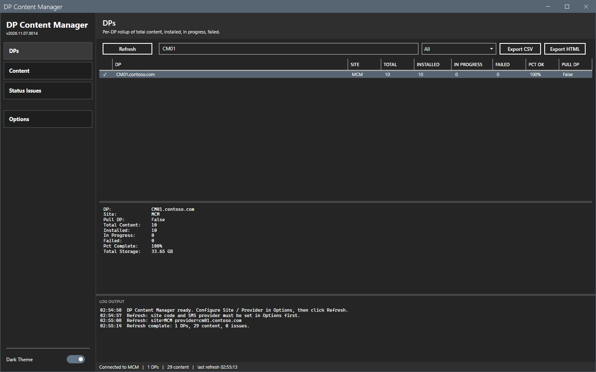
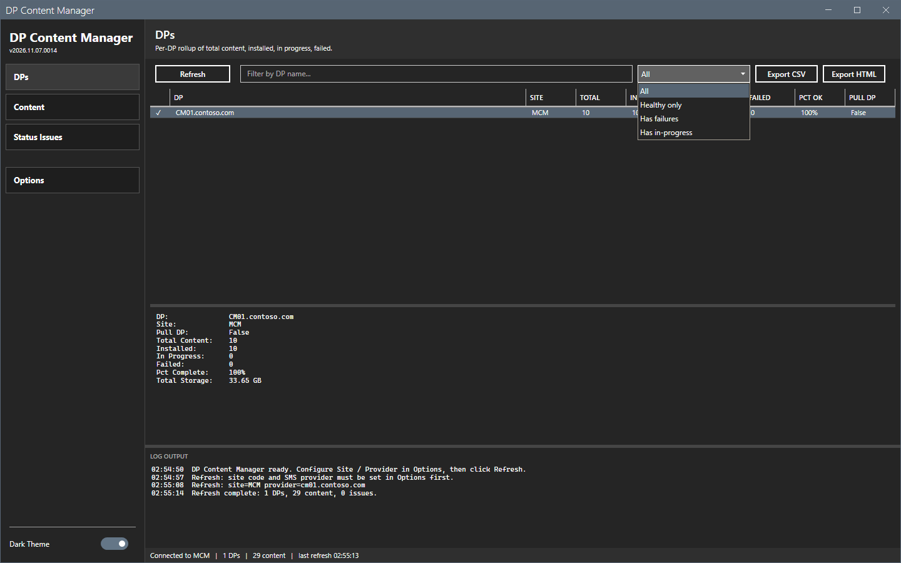
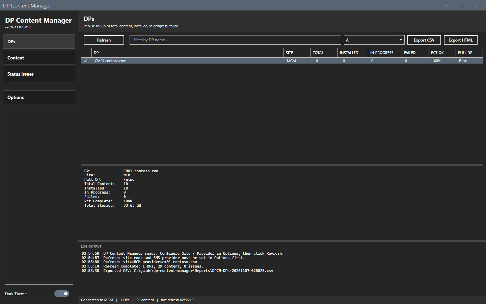

# DPs

The DPs view shows one row for each distribution point.

## What it does

Each row shows a status glyph, the DP name, the site, the total content, the number installed, in progress and failed, the percent OK and whether the DP is a pull DP. The pane below the grid shows the content roll-up of the selected DP and an estimate of its content size. The estimate is the sum of the source sizes of the content that has a status row on the DP, failed rows included. It is not the disk capacity or the free space of the DP.

## When to use it

Use it to see which distribution points have problems and how much content each one holds.

## Requirements

- A connection and a refresh. See [Getting started](../getting-started.md).

## Steps

### Read the roll-up

1. Select **DPs** in the sidebar and select **Refresh**.
2. Read the grid. A check mark means that the DP is healthy.

3. Select a row. The pane shows the roll-up and the size of the content on the DP.

### Filter the view

1. Type text in the filter box. The grid matches the DP name.
2. Select a status in the list: **All**, **Healthy only**, **Has failures** or **Has in-progress**.

### Export the view

1. Select **Export CSV** or **Export HTML**.
2. In the Save As dialog, keep the name or type a new name. The folder is `Reports` beside the script. The name is `DPCM-DPs-<date>-<time>`.
3. Select **Save**. The log shows `Exported CSV:` and the path.

## Options and settings of this page

| Control | Effect |
|---|---|
| **Refresh** | Reads all data from the site. |
| Filter box and status list | Filter the grid. |
| **Export CSV**, **Export HTML** | Write the shown rows. |

## Limits

- The view reads the site when you refresh. It does not update by itself.
- The export has the rows that the filter shows.

## Troubleshooting

| Message or symptom | Cause | Fix |
|---|---|---|
| The grid is empty. | No refresh has run. | Select **Refresh**. |
| `Export CSV: nothing to export.` | The grid has no rows. | Select **Refresh** or clear the filter. |

## Links

- [Content](content.md)
- [Status Issues](status-issues.md)
