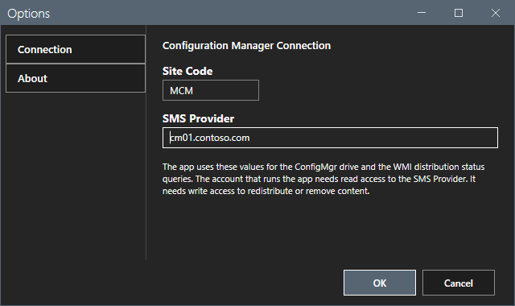
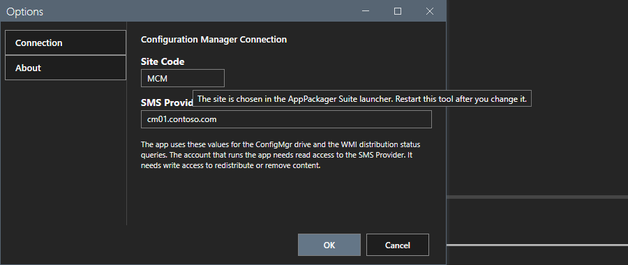
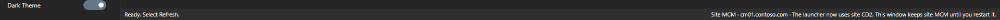
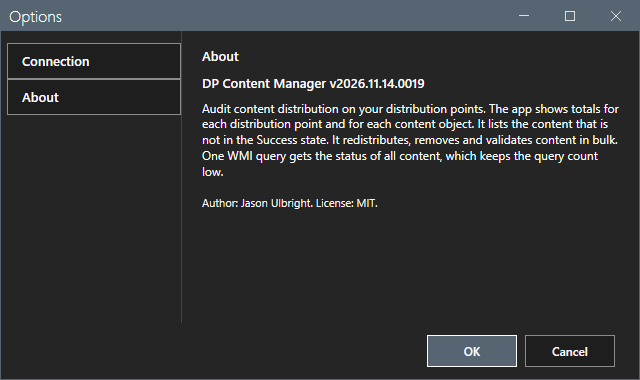
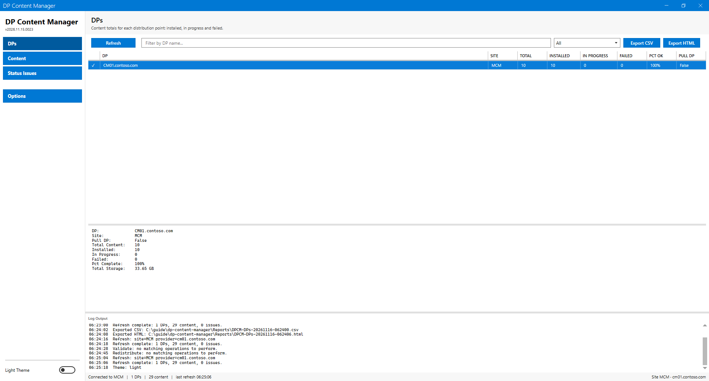
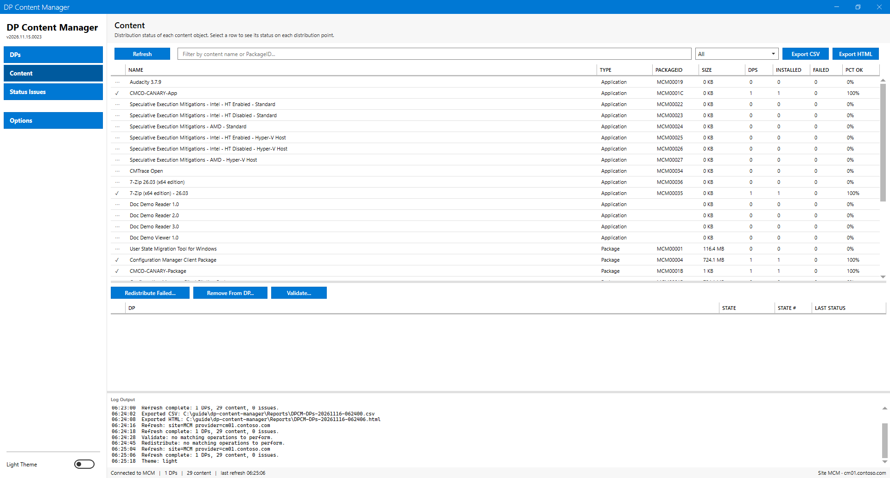
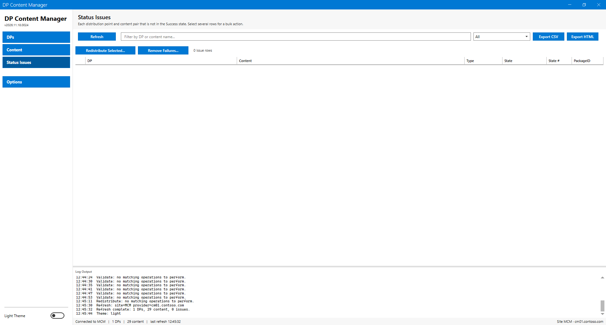
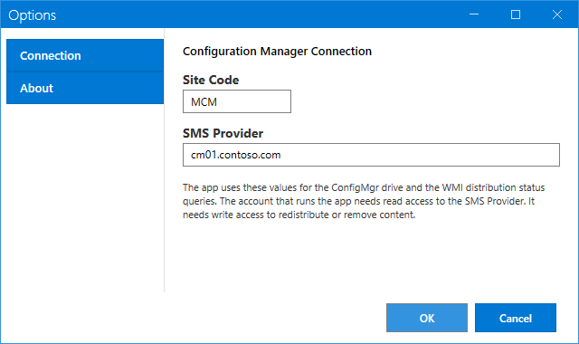
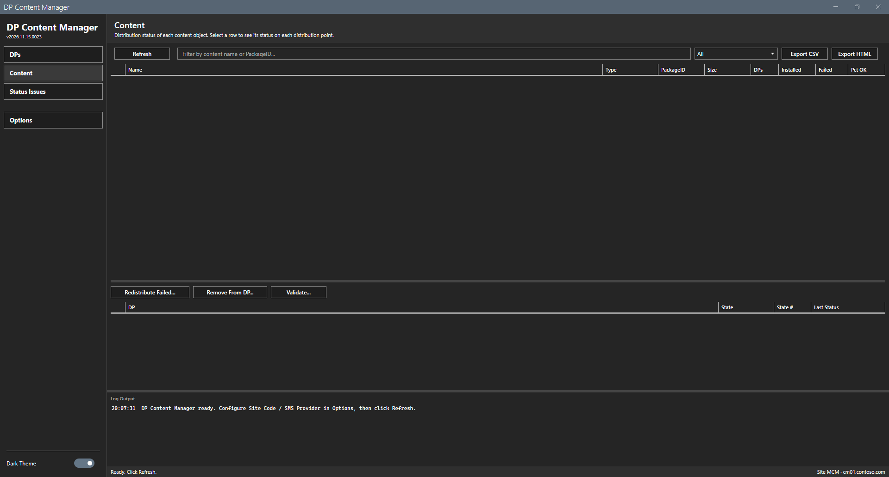

# Options dialog

The Options dialog sets the connection.

## What it does

The dialog has two pages: **Connection** and **About**. **OK** saves. **Cancel** or Esc closes the dialog and keeps the old values.

## When to use it

Use it at the first start and when the site changes.

## Requirements

None.

## Steps

### Connection

Select **Options** in the sidebar.

| Field | Meaning |
|---|---|
| **Site Code** | The site code, for example `MCM`. The field is read-only when the launcher chose a site. See [Sites](#sites). |
| **SMS Provider** | The server with the SMS Provider role. The tool uses it for the PSDrive root. |

### Site in the footer

The footer of the main window shows the site on the right, for example `Site MCM`, a middle dot, and `cm01.contoso.com`. It shows `Site not set` while the site code or the provider is empty. The footer is read-only. Select the site text to open Options. You change the provider only here. The launcher chooses the site code.

### Sites

The AppPackager Suite launcher chooses the site. When a site is chosen, **Site Code** is read-only. The tooltip says: The site is chosen in the AppPackager Suite launcher. Restart this tool after you change it. **SMS Provider** stays editable and is saved with the site.

The tool keeps its site data per site in `%LOCALAPPDATA%\AppPackagerData\sites\<SITE>\tools\dp-content-manager`, for example `sites\AB1\tools\dp-content-manager`. The site data are the site settings (`prefs.json`) and the `reports` folder. A site such as `CD2` has its own folder and shows none of the data of `AB1`.

A tool that is open keeps its site until you restart it. When the launcher chooses another site, the footer shows a note, for example: The launcher now uses site CD2. This window keeps site AB1 until you restart it.

The first start after an update copies the old data of the site into the site folder. The tool keeps the old files. The log shows `Site AB1; data in <folder>` at each start. When no site is chosen, the tool uses its old places beside the script. When no launcher chose a site, the `SiteCode` in `DPContentMgr.prefs.json` chooses it. To change it, edit that file, or choose the site in the launcher.

### About
The page shows the version and a short description.

### Theme

The **Dark Theme** switch at the bottom of the sidebar changes the theme. The tool keeps the choice. The theme changes colors only. The text size and weight stay the same.

The footer shows the status text and the site in the same style in both themes. Only the colors change.

### Start again

The tool saves the open view and the window place. After a restart the window shows the same view.

## Options and settings of this page

See the table above. [Settings](../reference/settings.md) lists the file keys.

## Limits

- **Refresh** needs both the site code and the provider.

## Troubleshooting

| Message or symptom | Cause | Fix |
|---|---|---|
| The status bar asks you to open Options. | The site code or the provider is empty. | Fill both fields. |

## Links

- [Settings](../reference/settings.md)
- [Getting started](../getting-started.md)
