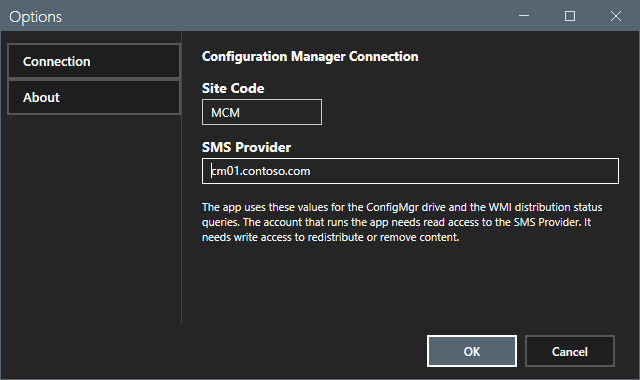
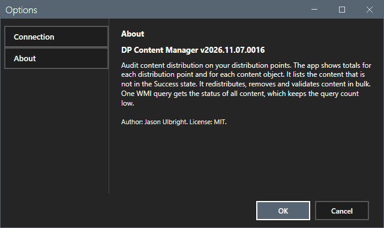
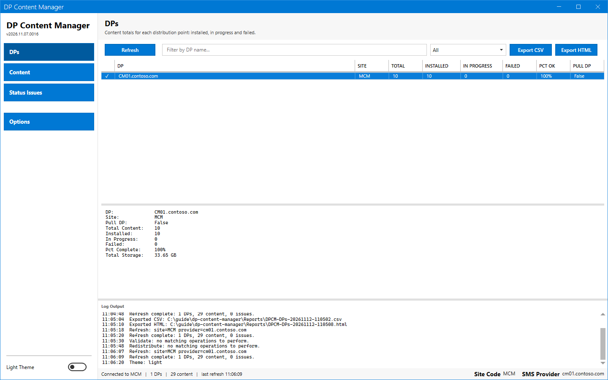
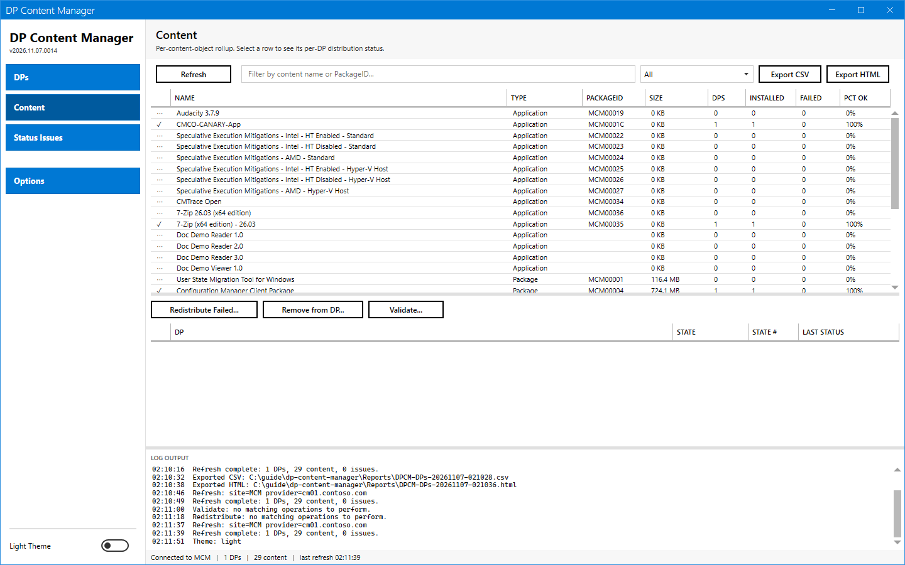
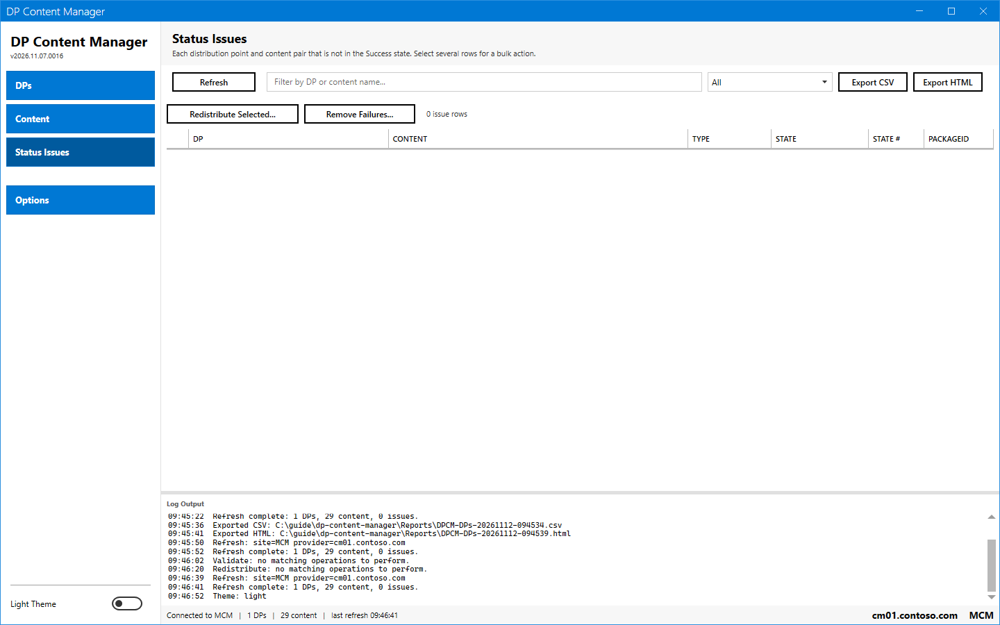
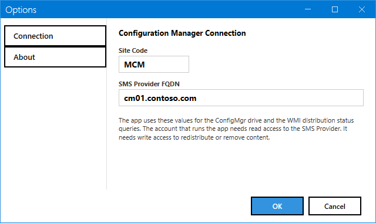
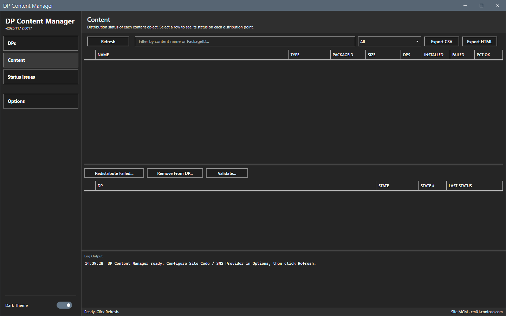

# Options dialog

The Options dialog sets the connection.

## What it does

The dialog has two pages: **Connection** and **About**. **OK** saves. **Cancel** or Esc closes the dialog and keeps the old values.

## When to use it

Use it at the first start and when the site changes.

## Requirements

None.

## Steps

### Connection

Select **Options** in the sidebar.

| Field | Meaning |
|---|---|
| **Site Code** | The site code, for example `MCM`. |
| **SMS Provider** | The server with the SMS Provider role. The tool uses it for the PSDrive root. |

### Site in the footer

The footer of the main window shows the site on the right, for example `Site MCM · cm01.contoso.com`. It shows `Site not set` while the site code or the provider is empty. The footer is read-only. Select the site text to open Options. You change the site code and the provider only here.

### About

The page shows the version and a short description.

### Theme

The **Dark Theme** switch at the bottom of the sidebar changes the theme. The tool keeps the choice. The theme changes colors only. The text size and weight stay the same.

The footer shows the status text and the site in the same style in both themes. Only the colors change.

### Start again

The tool saves the open view and the window place. After a restart the window shows the same view.

## Options and settings of this page

See the table above. [Settings](../reference/settings.md) lists the file keys.

## Limits

- **Refresh** needs both the site code and the provider.

## Troubleshooting

| Message or symptom | Cause | Fix |
|---|---|---|
| The status bar asks you to open Options. | The site code or the provider is empty. | Fill both fields. |

## Links

- [Settings](../reference/settings.md)
- [Getting started](../getting-started.md)
