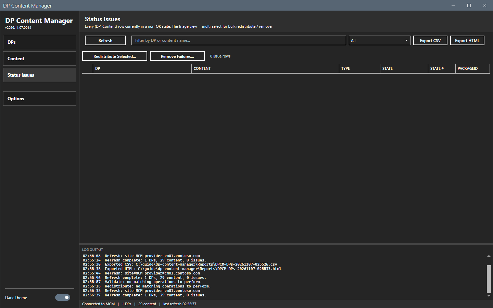

# Status Issues

The Status Issues view lists every (DP, content) pair that is in a non-OK state.

## What it does

Each row shows a DP, a content object, the type, the state, the state number and the package ID. The counter shows the number of issue rows. Select several rows and use **Redistribute Selected...** or **Remove Failures...** to fix them in bulk.

## When to use it

Use it as the triage list after a refresh: it shows only the problems.

## Requirements

- A connection and a refresh. See [Getting started](../getting-started.md).
- For the two buttons: Configuration Manager rights to redistribute and remove content.

## Steps

### Read the issues

1. Select **Status Issues** in the sidebar. The view is empty before the first refresh.

2. Select **Refresh**. The counter shows `<n> issue rows`. A site without problems shows `0 issue rows` and an empty grid.

### Filter the view

1. Type text in the filter box. The grid matches the DP and the content name.
2. Select a state in the list: **All**, **Failed only** or **In progress only**.

### Fix the issues

1. Select one or more rows. Use Ctrl or Shift to select several.
2. Select **Redistribute Selected...** or **Remove Failures...**. A preview dialog lists every (DP, content) pair. See [Bulk action dialog](bulk-actions.md).

The lab site has no issue rows, so this guide did not open these two previews. They work like the previews of the [Content](content.md) view.

## Options and settings of this page

| Control | Effect |
|---|---|
| **Refresh** | Reads all data from the site. |
| Filter box and state list | Filter the grid. |
| **Export CSV**, **Export HTML** | Write the shown rows. |
| **Redistribute Selected...** | Previews a redistribution of the selected pairs. |
| **Remove Failures...** | Previews the removal of the selected pairs. |

## Limits

- The two buttons act only on the selected rows.
- A multi-selection is needed for several pairs. Without a selection the log says to select issue rows first.

## Troubleshooting

| Message or symptom | Cause | Fix |
|---|---|---|
| `Redistribute Selected Issues: multi-select issue rows first.` | No row is selected. | Select rows. |
| `Redistribute: refresh first.` | No refresh has run. | Select **Refresh**. |

## Links

- [Content](content.md)
- [Bulk action dialog](bulk-actions.md)
