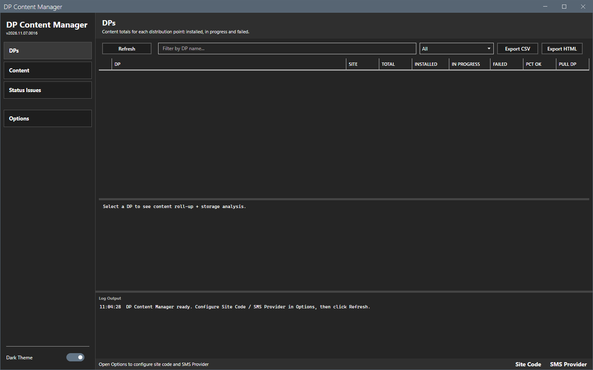
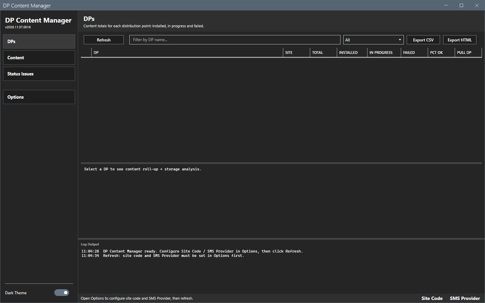
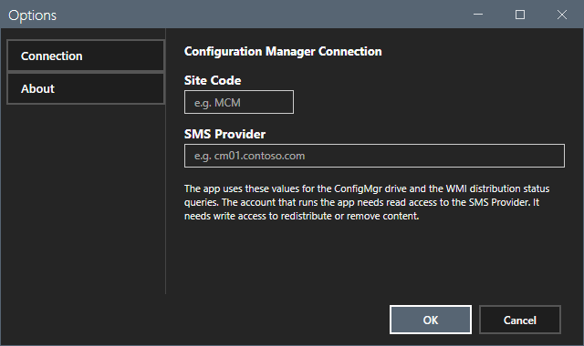
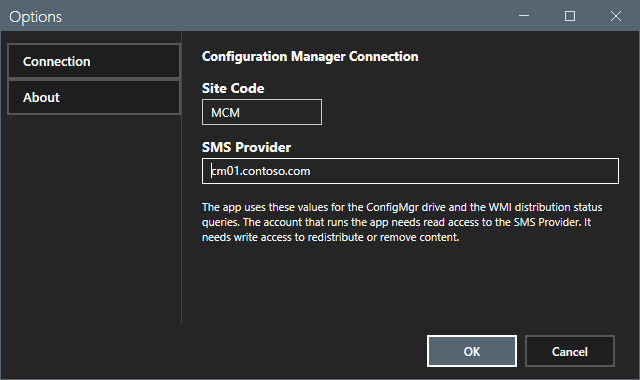
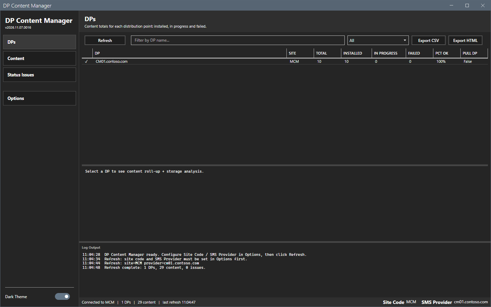
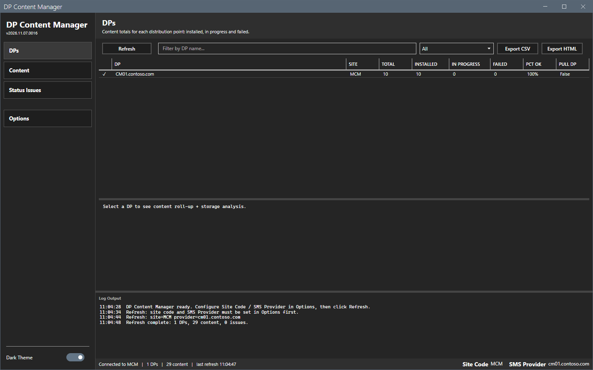

# Getting started

This page shows how to start DP Content Manager, set the connection and load the data.

## What it does

The tool reads the distribution status of all content on all distribution points of a Configuration Manager site with one query. It shows the data as a roll-up for each DP, a roll-up for each content object and a list of the problems. It can redistribute failed content, remove content from DPs and validate content, after you review the list.

## When to use it

Use it to find content that failed on a distribution point, to fix it in bulk, and to see how much content each DP holds.

## Requirements

- Windows 10, Windows 11 or Windows Server 2016 or later, PowerShell 5.1 and .NET Framework 4.7.2 or later.
- The Configuration Manager console. The tool loads the `ConfigurationManager` PowerShell module of the console. Without the console, **Refresh** fails with a message in the log. See [Error messages](reference/error-messages.md).
- Configuration Manager rights to read DP content, and to redistribute and remove content for the bulk actions. See [Permissions](reference/permissions.md).

## Steps

### Start the tool

1. Extract the release zip to a folder that you can write to. The tool saves its settings, logs and reports in that folder.
2. Right-click `start-dpcontentmgr.ps1` and select **Run with PowerShell**. Or run this command:

```powershell
powershell -ExecutionPolicy Bypass -File start-dpcontentmgr.ps1
```

The window opens on the **DPs** view. The window of the first start is empty.



If you select **Refresh** before you set the connection, the log asks you to open Options.



### Set the connection

1. Select **Options** in the sidebar.
2. Type the **Site Code**, for example `MCM`.
3. Type the **SMS Provider** name as a FQDN, for example `cm01.contoso.com`.
4. Select **OK**.





### Load the data

1. Select **Refresh**. A progress overlay shows.
2. Wait for the log to show `Refresh complete: <n> DPs, <n> content, <n> issues.`





## Options and settings of this page

None. The settings are on [Options dialog](core/options.md).

## Limits

- Every view needs a refresh first. A view is empty until then.
- One refresh loads the data of all three views.

## Troubleshooting

| Message or symptom | Cause | Fix |
|---|---|---|
| The log shows `Refresh: site code and SMS Provider must be set in Options first.` | The site code or the provider is empty. | Set the connection. |
| The log shows `Refresh failed: Failed to connect to site <code> (provider <name>).` | The console is not installed on this computer, or the provider name is wrong, or `SMS_ADMIN_UI_PATH` does not point to the `bin\i386` folder of the console. | Check the provider name. Install the console. If it is installed, set `SMS_ADMIN_UI_PATH` to its `bin\i386` folder and start the tool again. |

## Links

- [DPs](core/dps.md)
- [Options dialog](core/options.md)
- [Troubleshooting](troubleshooting.md)
