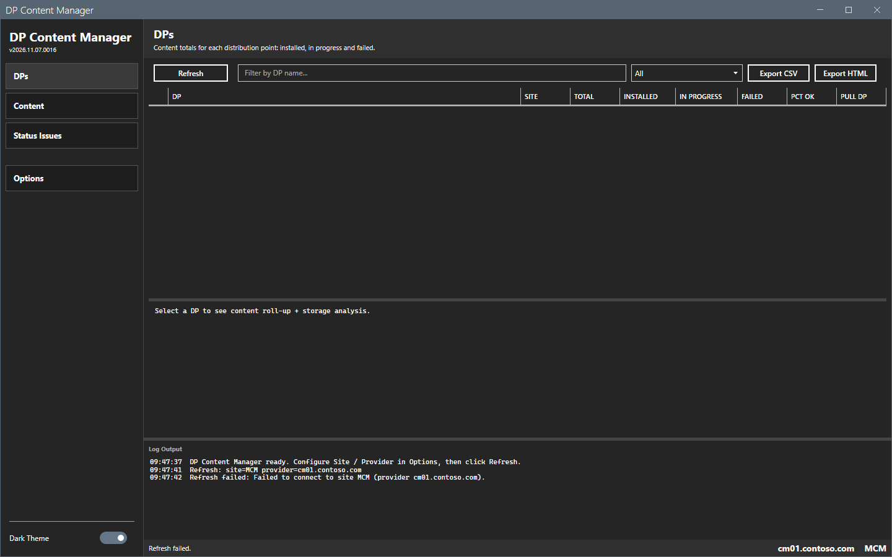

# Error messages

This page lists the messages of DP Content Manager with cause and fix. The messages show in the log pane and in the status bar.

## What it does

It maps a message to its cause and to a fix.

## When to use it

Use it when a refresh or a bulk action does not work.

## Requirements

None.

## Messages

| Message | Where | Cause | Fix |
|---|---|---|---|
| `Refresh: site code and SMS provider must be set in Options first.` | Log | The site code or the provider is empty. | Set both in **Options > Connection**. |
| `Refresh failed: Failed to connect to site <code> (provider <name>).` | Log | The console is not installed on this computer, or the provider name is wrong or not reachable, or `SMS_ADMIN_UI_PATH` does not point to the `bin\i386` folder of the console. | Check the provider name. Install the console. If it is installed, set `SMS_ADMIN_UI_PATH` to its `bin\i386` folder and start the tool again. |
| `Refresh failed: The refresh failed.` | Log | The tool could not read the site. The log file has the system message. | Read the log file. Check the connection and the role. |
| `<action>: select one or more content rows first.` | Log | No row is selected on the Content view. | Select rows. |
| `<action>: multi-select issue rows first.` | Log | No row is selected on the Status Issues view. | Select rows. |
| `<action>: refresh first to establish a CM connection.` and `<action>: refresh first.` | Log | No refresh has run. | Select **Refresh**. |
| `<action>: no matching operations to perform.` | Log | The selection has no (DP, content) pair for the action. | Select other rows. |
| `<action>: <n> succeeded, <n> failed across <n> operations.` | Log | The result of a run. | Read the log file for the reason of each failure. |
| `Export CSV: nothing to export.` and `Export HTML: nothing to export.` | Log | The grid has no rows. | Select **Refresh** or clear the filter. |

The image shows **Refresh** on a computer without the console. The window stays open, the grid stays empty and the log names the cause.

If the window closes without a message, read the crash log `Logs\DPCM-crash-<date>-<time>.txt` and the startup transcript in `Logs`.

## Steps

1. Find the message in the table.
2. Do the fix.
3. Run the action again.

## Limits

- The messages are in English.

## Troubleshooting

See [Troubleshooting](../troubleshooting.md).

## Links

- [Troubleshooting](../troubleshooting.md)
- [Permissions](permissions.md)
